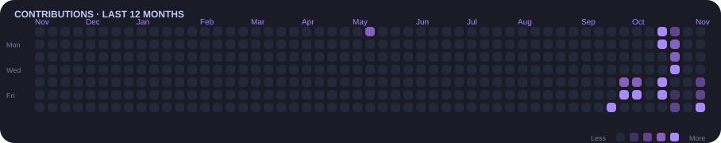

**Open Source Developer** · **Independent Developer** · **Linux Enthusiast**

---

## 👋 About

Développeur indépendant passionné par Linux, les systèmes et l'open source. J'explore l'intelligence artificielle locale, le développement web et l'automatisation Linux, avec une idée simple : comprendre ce que l'on utilise pour mieux construire.

---

## 🛠️ Tech Stack

---

## 🐧 Linux Environments

---

## 🚀 Featured Projects

<!-- PROJECTS:START -->

<em>New projects coming soon.</em>

<!-- PROJECTS:END -->

---

## 📊 GitHub Overview

---

## 💻 Most Used Languages

---

## 🔥 Contribution Streak

---

## 🗓️ Contribution Calendar

---

## 🏆 GitHub Achievements

---

## 🧭 Engineering Principles

<table align="center">
  <tr>
    <td width="33%" valign="top">
      <h3>🔍 Understand</h3>
      Understand how systems work instead of relying blindly on abstractions.
    </td>
    <td width="33%" valign="top">
      <h3>✂️ Simplify</h3>
      Prefer clear, maintainable and purposeful solutions.
    </td>
    <td width="33%" valign="top">
      <h3>🧪 Experiment</h3>
      Explore technologies, test ideas and learn continuously.
    </td>
  </tr>
  <tr>
    <td valign="top">
      <h3>🔨 Build</h3>
      Create useful tools and meaningful projects.
    </td>
    <td valign="top">
      <h3>🤝 Share</h3>
      Value open source, collaboration and shared knowledge.
    </td>
    <td valign="top">
      <h3>🎛️ Control</h3>
      Understand and customize the environment you work in.
    </td>
  </tr>
</table>

---

