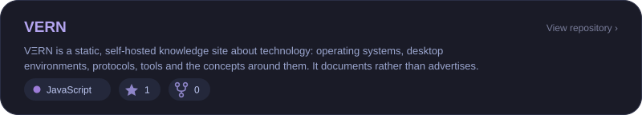
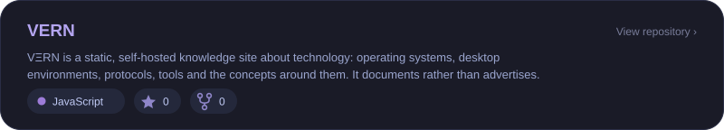
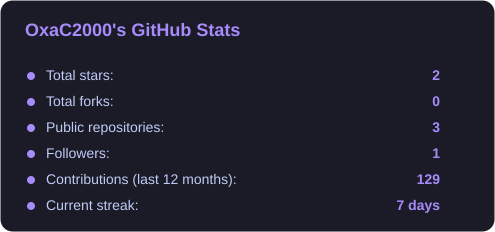
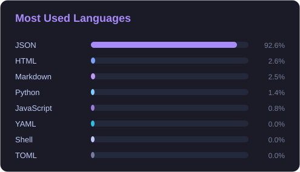

**Open Source Developer** · **Independent Developer** · **Linux Enthusiast**

---

## About

Independent developer passionate about Linux, systems and open source. I explore local artificial intelligence, web development and Linux automation, with one simple idea: understand what you use in order to build better.

---

## Tech Stack

---

## Linux Environments

---

## Featured Projects

<!-- PROJECTS:START -->

  

  

  

<!-- PROJECTS:END -->

---

## GitHub Overview

---

## Most Used Languages

---

## Contribution Streak

---

## Contribution Calendar

---

